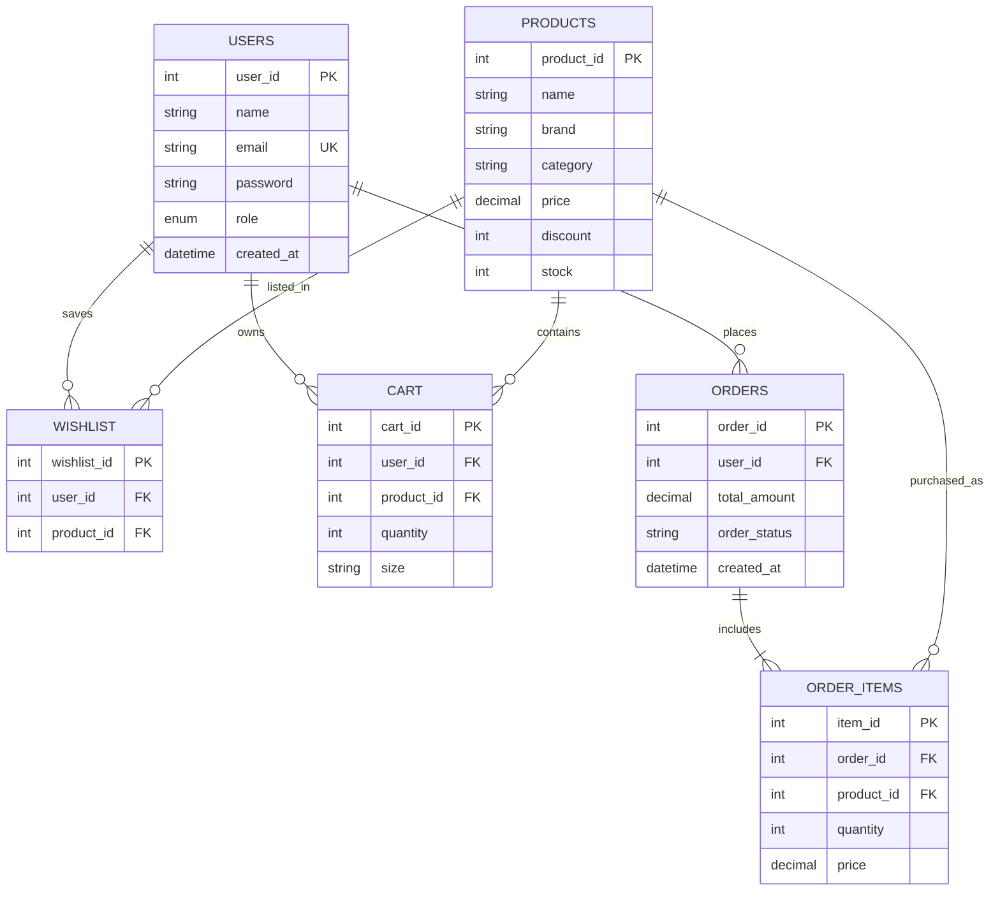

# Myntra Studio — educational e-commerce replica

Myntra Studio is a responsive PHP/MySQL fashion storefront created for a Web Technology activity. It is an educational replica, not affiliated with Myntra. Product browsing, user accounts, wishlist, cart, inventory, and simulated orders use MySQL; feedback uses a local text file. Checkout never requests or processes payment credentials.

## Technology

- HTML5, CSS3, responsive layouts, and vanilla JavaScript
- PHP 8+ (PDO, sessions, password hashing, file I/O)
- MySQL 8+ / MariaDB on XAMPP; phpMyAdmin for importing and inspecting data
- External product photography served from Unsplash URLs (internet access is needed for images)

## XAMPP installation

1. Copy this project folder to `C:\xampp\htdocs\MYNTRA`.
2. Open the XAMPP Control Panel and start **Apache** and **MySQL**.
3. Visit `http://localhost/phpmyadmin`, choose **Import**, select `database.sql`, and run the import. It creates `myntra_replica`, its related tables, 22 sample products, and the demo administrator account.
4. If your MySQL credentials differ from XAMPP's defaults, provide `DB_HOST`, `DB_NAME`, `DB_USER`, and `DB_PASSWORD` as environment variables to the PHP/Apache process. Do not put private database credentials in tracked project files.
5. Ensure PHP's `pdo_mysql` extension is enabled in `C:\xampp\php\php.ini`; restart Apache after changing PHP settings.
6. Make the project folder writable by the Apache/PHP process so the feedback module can create and update its local `feedback.txt` file. That file is ignored by Git because it can contain personal submissions.
7. Open `http://localhost/MYNTRA/`.

No Composer, npm, or frontend framework is required. The site needs MySQL for product and account pages; database connection errors explain the expected setup.

### Local administrator setup

- The SQL seed creates the local administrator account `admin@myntra.local` with a randomly generated, undisclosed password hash. Set a private password before signing in; do not commit or share it.
- **Customer:** register a new account at `/register.php`.

To set the local administrator password, generate a hash with the PHP executable bundled in XAMPP, then update the seeded account in phpMyAdmin:

1. In Command Prompt, run `C:\xampp\php\php.exe -r "echo password_hash('REPLACE_WITH_YOUR_PRIVATE_PASSWORD', PASSWORD_DEFAULT), PHP_EOL;"`. Replace the placeholder locally with a private password; do not save or publish that password in project files.
2. Copy the generated hash and run this query in phpMyAdmin's SQL tab, replacing the hash placeholder:

   ```sql
   UPDATE users
   SET password = 'PASTE_THE_GENERATED_HASH_HERE'
   WHERE email = 'admin@myntra.local' AND role = 'admin';
   ```

The application verifies the resulting hash with `password_verify()`. Public registration always creates a customer-role account.

## Modules

| Module | What it demonstrates |
|---|---|
| `index.php`, `products.php`, `product-details.php` | Storefront, product search, category/brand/price filters, sorting, stock-aware product detail |
| `register.php`, `login.php`, `logout.php` | Server/client validation, password hashing, sessions, session ID renewal and logout |
| `wishlist.php`, `cart.php` | User-specific product CRUD, size selection, quantity/stock limits, subtotal and `FASHION10` coupon |
| `checkout.php` | Address/PIN server validation, row locking, transaction-safe stock deduction, order and order-item creation; simulated confirmation |
| `admin/login.php`, `admin/dashboard.php` | Role-protected sign-in and product create/read/update/delete, search and low-stock alerts |
| `feedback.php`, `feedback.txt` | File-backed create/read/update/delete using `fopen`, `fread`, `fwrite`, `file_get_contents` and `file_put_contents` |
| `interaction-demo.php`, `js/script.js` | Click/mouse/keyboard events, coordinates, contextual help, hover stacking, live DOM filtering |
| `includes/` | Shared PDO connection, validation/security helpers, reusable header/footer and product card |

All SQL values are parameterized. Output is HTML-escaped. POST forms use a session CSRF token. The last visit cookie is HttpOnly and SameSite=Lax.

## Database schema and ER diagram

`database.sql` is the authoritative schema and sample data. Tables and foreign keys:



## Validation and test cases

Run each case in a browser after importing the database:

| # | Test | Expected result |
|---|---|---|
| 1 | Open home, category tiles, product catalogue and product details | Shared navigation/footer; seeded product images and details render |
| 2 | Search for a product/brand, select category and brand, set min/max price, sort both directions | Server-side results reflect filters; live name/category filtering updates cards |
| 3 | Register with invalid name/email/password, then valid values | Clear client-side field errors; server rejects invalid values; valid account is stored hashed |
| 4 | Log in with customer account, then log out | Session starts with authenticated identity; logout destroys it |
| 5 | Add product to wishlist; move to bag; remove item | Wishlist CRUD works only for signed-in user and updates cart |
| 6 | Add product to bag, raise/lower quantity and remove it | Bag count, line totals, subtotal and quantity update; cannot exceed available stock |
| 7 | Apply `FASHION10`, then an invalid coupon | Valid coupon applies 10%; invalid code is rejected and cleared |
| 8 | Complete checkout with invalid/valid PIN and address | Invalid data is rejected; simulated order, order items and stock update commit together |
| 9 | Set product stock to 2 in admin, then order 3 | Admin shows low-stock warning; storefront/cart/checkout prevent ordering above stock |
| 10 | Admin adds, searches, edits stock/details, and deletes a product | Product inventory CRUD is persisted in MySQL; protected from customer-role accounts |
| 11 | Submit, edit, view, and delete feedback | `feedback.txt` is updated; no feedback writes go to MySQL |
| 12 | Use the interaction lab | Mouse coordinates/click, keyboard event, contextual help, panel stacking and DOM filter respond |
| 13 | Return to home on a later visit | Previous visit timestamp appears using the last-visit cookie |
| 14 | Submit HTML/script-like text in feedback/product fields | Rendered output is escaped and does not execute as markup/script |

## Notes

- The six-digit PIN is format-validated only; no address verification or real delivery is performed.
- `FASHION10` applies a 10% discount to the item subtotal, with no external payment gateway.
- To reset demo data, re-import `database.sql` after dropping the local `myntra_replica` database in phpMyAdmin.
